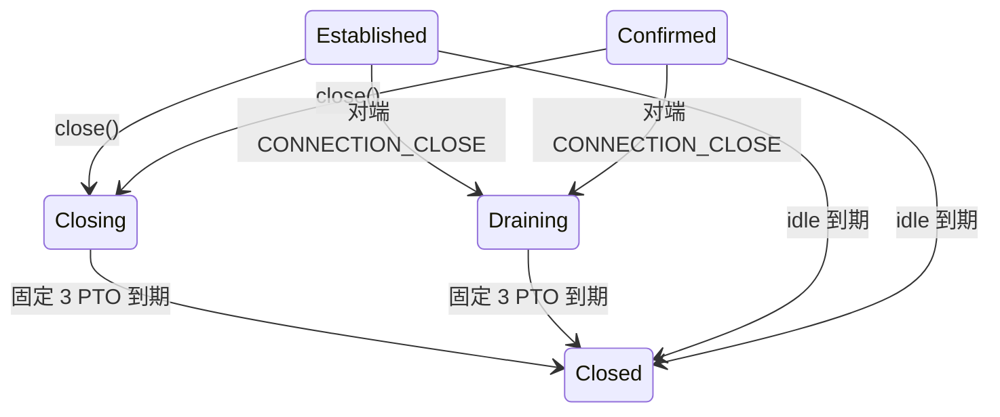

# 连接关闭、Draining 与空闲超时

`HandshakeConnection` 现在支持应用主动关闭、对端关闭的到期回收，以及协商的空闲超时。它仍是单线程、固定 UDP 对端的 sans-I/O 引擎，调用方继续使用 `next_timeout_us()` / `on_timeout()` 驱动。

## 主动关闭与状态

TLS 完成后调用 `close(application_error = 0, reason = {})`。错误码不得超过 QUIC varint 上限，原因最多 256 字节；不合法输入返回 false，不改变当前状态。重复 close 返回 false，不覆盖第一个原因。`close_info()` 返回本地申请或已认证对端关闭帧的信息，包括应用/传输类别、错误码、触发帧和原因。诊断信息在 Closed 后仍可读取。

握手中也能收到传输关闭并进入 Draining；上图只画常用路径。Failed 表示无法封包等本地静默终止；认证协议/TLS 错误现已转为 Closing，接收结果仍报告 Failed（见 error-close.md），首个传输错误可由 `transport_error()` 查询；它不是 Closing 的别名。

本地 close 先分配一个新的应用包号、封装 1-RTT CONNECTION_CLOSE，再立即释放 TLS、流、待密文、ACK/恢复记录和物理在途记账。Closing 只保留路由信息、已经加密的关闭包、诊断与期限。流操作不再接受，排队 PING/STREAM 不再输出。

关闭包不进入普通丢包恢复或拥塞/pacing 调度；仍服从反放大额度。没有接收密钥时还单独限制 Closing 发出总量不超过累计归属到本连接接收量的三倍，包括已有接收信用。错误地址或 CID 不贡献信用、不触发回复。相同地址/CID 只能表示归属，不能表示内容已认证。

第一次 `poll_transmit()` 交付关闭包。后续必须有归属流量到达才可能回复，第一次至少等待 1 PTO，后续间隔翻倍。单纯定时器到期不重发，重复 poll 不额外输出。回复复用完全相同的密文，这是 [RFC 9000 §10.2.1](https://www.rfc-editor.org/rfc/rfc9000.html#section-10.2.1) 明确允许的关闭例外。原始 Closing 期限始终不延长。

收到已认证的 CONNECTION_CLOSE 进入 Draining，不回显任何包；3 PTO 到期后 Closed。Draining 不保留 TLS/流/恢复数据。Closing 不解密入站，因此未实现可选的 Closing→Draining 转换，仍按原期限停止。

## 空闲超时

传输参数 `max_idle_timeout`（0x01）单位为毫秒，默认 0。两个非零值取较小者；仅一个非零取该值；都为 0 则禁用。在取得对端参数前使用本地值。因此禁用默认值不会为旧测试和调用方凭空添加定时器。

期限从以下活动时间计算：

- 收到并成功处理新的已认证包后刷新；伪造、错误路由、重复包号不刷新。重复包可以触发 ACK，但不能通过重放旧密文让空闲连接永久存活。
- 自上次成功接收后，第一次实际交付给调用方的 ack-eliciting 包刷新。仅排队不刷新，后续连续发送不刷新，ACK-only 不刷新。

实际期限为 `last_activity + max(协商值, 3 × 当前基础 PTO)`。PTO 来自当前 RTT，不使用恢复层的指数退避；确认后才计应用 ACK delay。RTT/参数改变时从原活动时间重新求期限。毫秒换算、三倍乘法和绝对期限加法均采用饱和算术。

空闲到期静默释放状态并进入 Closed，不发 CONNECTION_CLOSE。反放大阻塞只暂停恢复发送，不屏蔽空闲或终态计时；`receive()`、`poll_transmit()` 和 `close()` 也会先检查到期，避免漏调定时回调后复活连接。应用仍应及时驱动定时器，而非依赖访问器推进时间。语义依据 [RFC 9000 §10.1](https://www.rfc-editor.org/rfc/rfc9000.html#section-10.1)。

## 验证与范围

`quic_connection_lifecycle` 使用真实 TLS 和受保护包、确定性时钟验证：对端 Initial 关闭、主动 1-RTT 关闭及首包丢失、首次回复前拒绝/后续间隔翻倍、定时器不主动重发、错误源/CID、流与在途清理、Draining 静默及边界到期；另覆盖双方/单方非零空闲协商、禁用默认、三倍 PTO 下限、首次实际发送刷新、重复发送/ACK-only/伪造与重放不保活、反放大阻塞下到期和整数上限饱和。

独立审查未发现生产代码缺陷；补充了限速与反放大阻塞下的到期测试。独立三倍上限的耗尽分支未通过伪造内部计数覆盖：该阶段的应用 close 需要握手完成，已有握手接收信用（后续错误关闭含 Initial 时缓存包可达 1200 字节，仍独立检查三倍上限）；当前 3 PTO 寿命与 PTO/2PTO 间隔最多交付两份、有 256 字节原因上限的关闭包，先受限速约束。该上限保留用于无接收密钥路径的纵深约束。

本地协议/TLS 错误自动传输关闭及握手确认前多保护级别关闭已在 [error-close.md](error-close.md) 接入。仍缺 stateless reset、监听器 tombstone/CID 路由和第三方互通。调用方还需从外层连接表清理 Closed 对象；引擎不会替调用方释放 C++ 对象或关闭共享 UDP socket。

最终验证：全量 CTest **58/65**（159.82 秒），其中 QUIC **27/27**，包含公共编译夹具，对应 25 个 QUIC 测试程序与其中一个程序的第二入口。新生命周期测试 3.16 秒。仍为五项既有超时 wrapping_integers_roundtrip、wrapping_integers_extra、recv_transmit、recv_reorder_more、send_transmit；net_interface、router 缺少可执行文件，无新增失败。命令：ctest --test-dir build --output-on-failure --timeout 30 -j2。格式、差异空白和 Markdown 本地链接另行检查。

认证协议/TLS 错误关闭、TLS 写密钥缓存及握手多保护级别通知已实现，接口差异与验证见 [error-close.md](error-close.md)。
