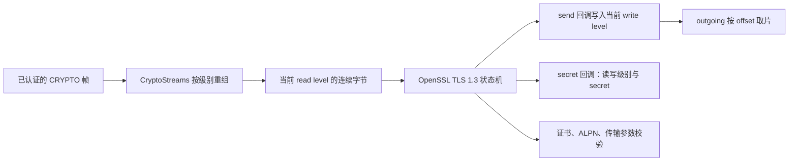

# TLS 1.3 握手接入

`quic/tls_handshake.hh/.cc` 让真正的 TLS 1.3 状态机通过 `CryptoStreams` 收发握手字节。TLS 使用 OpenSSL 3.5 的 external QUIC TLS 回调接口；包头、AEAD、包号、ACK 和重传仍由本项目实现。原设计中的 BoringSSL 探针候选改为 OpenSSL 3.5.9，与已有 Initial 密码原语共用库。

依据：[RFC 9001 §4](https://www.rfc-editor.org/rfc/rfc9001.html#section-4)、[§8](https://www.rfc-editor.org/rfc/rfc9001.html#section-8)，以及 [OpenSSL 官方接口说明](https://docs.openssl.org/3.5/man3/SSL_set_quic_tls_cbs/)。

## 为什么 TLS 不直接读写 socket

QUIC 把 TLS 握手消息装入 CRYPTO 帧，使用自己的包保护替代 TLS record layer。TLS 交出的 `traffic secret` 是后续派生 QUIC key、iv、hp 的输入，不是直接可用的包密钥。现在已由 `protected_packet.*` 将这些 secret 展开为包密钥并保护 Handshake/1-RTT 整包，见 [protected-packets.md](protected-packets.md)。



TLS 首先在 Initial 级别收发 ClientHello/ServerHello；`yield_secret` 回调随后分别推进读、写级别。两方向不能共用一个当前级别。例如服务端发完 Finished 时已具备 1-RTT 写 secret，仍要用 Handshake 读 secret 验证客户端 Finished。

`recv` 只取当前读级别的连续数据。测试故意先送 Handshake 帧、再送 Initial 帧，每级别倒序送片并重复，验证未来级别不会提前交给 TLS。OpenSSL 可以在调用返回后继续持有 `recv` 给出的指针，因此 `input_record` 必须一直有效，直到 `release` 回调。析构时先释放 SSL，再释放缓冲和配置；回调不允许 C++ 异常跨越 C 接口。

## 构建依赖

虚拟机目标为 Linux ARM64。`scripts/build-quic-openssl.sh` 固定官方 `openssl-3.5.9` tag 的源码归档，校验 SHA256 后在当前工作树 `build/deps` 内编译静态库；不使用 sudo，不改系统 OpenSSL。

```sh
bash scripts/build-quic-openssl.sh
cmake -S . -B build \
  -DOPENSSL_ROOT_DIR="$PWD/build/deps/openssl-3.5.9" \
  -DOPENSSL_INCLUDE_DIR="$PWD/build/deps/openssl-3.5.9/include" \
  -DOPENSSL_CRYPTO_LIBRARY="$PWD/build/deps/openssl-3.5.9/lib/libcrypto.a" \
  -DOPENSSL_SSL_LIBRARY="$PWD/build/deps/openssl-3.5.9/lib/libssl.a" \
  -DOPENSSL_USE_STATIC_LIBS=TRUE
cmake --build build --target functionality_testing quic_debug -j2
ctest --test-dir build -R 'quic_' --output-on-failure --timeout 30
```

若虚拟机不能访问 GitHub，可在宿主机下载
`https://codeload.github.com/openssl/openssl/tar.gz/refs/tags/openssl-3.5.9`，
传到 `build/deps/openssl-3.5.9-source.tar.gz`，或将路径作为脚本第一个参数。
这个 **tag 归档** 的 SHA256 是
`796831ec533bf41998eaaee9d632d921b8a69f57394fa4086ff01a941113d26d`；
它不是 GitHub release 附件，不能套用 release tarball 的校验值。此处固定的是下载内容哈希，没有声称进行上游签名验证。
构建夹具每次检查证书有效期，剩余不足一天则重新生成，避免增量构建长期复用过期证书。
CMake 要求 OpenSSL ≥3.5 的 SSL/Crypto，并编译链接检查 external QUIC TLS 符号。测试另用 `openssl` 命令生成仅用于测试的临时证书及私钥，放在忽略的构建目录，不能用于实际服务。

## 配置与推进

`TlsConfig` 持有字符串和参数的副本。客户端必须给出 `server_name`、显式 CA 文件、ALPN，以及从真实 Initial/Retry 包头取得的对端 CID 上下文；服务端必须给出证书链、私钥、ALPN。两个角色都必须提供含 `initial_source_connection_id` 的本端参数；服务端还须提供 `original_destination_connection_id`。参数和 CID 按已有 codec 校验。配置或文件装载失败抛异常；握手启动后的协议错误记为终止状态。

调用顺序：创建对象 → `advance()` 生成或消费握手消息 → 用 `outgoing(level, offset, max_data)` 取待封包片段 → 对端认证解密并解析后调用 `receive(level, frame)` → 再 `advance()`。发送字节保留供重分片；调用方跟踪已发 offset，重传可重复读取旧 offset。

| 接口 | 含义 |
| --- | --- |
| `advance()` | 返回 NeedData、Complete 或 Failed；失败不能重新启动 |
| `receive()` | 缓冲经包认证的 CRYPTO 数据，继承重组、重复和容量规则 |
| `outgoing()` | 提供 TLS 已产生的 CRYPTO 字节，不执行包保护或发送 |
| `secret(level, write)` | 取本端读/写 traffic secret；Initial 和 0-RTT 不提供；副本由调用方负责保密 |
| `peer_parameters()`、`negotiated_alpn()` | 仅握手成功后提供结果 |
| `transport_error()` | 提供连接层将来要发送的关闭错误码；当前不发送 CONNECTION_CLOSE |

默认每级别收、发上限各 64 KiB；接收上限至少 4096。OpenSSL 持有的一个输入缓冲独立于 CRYPTO 未读缓冲，此外 TLS 自身也有握手状态内存；这些限额不是整个连接的总内存上限。发送缓冲满不会静默丢数据，直接终止为内部错误。

| 失败 | QUIC 错误码 |
| --- | --- |
| 原 CRYPTO 格式/重叠/缓冲错误 | 保留原来的 0x07 / 0x0a / 0x0d |
| 旧读级别仍有残留数据、迟到帧扩展旧级别，或 OpenSSL 明确报告级别切换的 record 边界错误 | 0x0a PROTOCOL_VIOLATION |
| 对端传输参数非法或 CID 不匹配 | 0x08 TRANSPORT_PARAMETER_ERROR |
| 其余 TLS alert，包括证书或 ALPN 错误 | 0x100 + alert |
| 其他回调/内部错误，包括发送队列耗尽 | 0x01 INTERNAL_ERROR |

TLS 边界错误映射仅识别 OpenSSL 的 `SSL_R_NOT_ON_RECORD_BOUNDARY`，不把其他 unexpected_message alert 一概转换。

第一次错误固定后不被后续 TLS alert 覆盖。失败会清理内部保存的 traffic secret，并停止暴露发送数据和协商结果；此前调用方已取得的 secret 副本不能由适配器撤回。

## 验证范围和下一步

`tests/quic_tls_handshake.cc` 使用构建时生成的 localhost 证书，测试真实双端握手、分级别乱序与重复、两个方向的 Handshake/1-RTT secret 相等关系，以及错误 CA、主机名、ALPN、CID、CRYPTO 重叠、接收/发送上限、0-RTT 和非法配置；另覆盖每输入 13 字节就推进一次 TLS、旧级别有缺口/连续残留、迟到扩展与合法重传，以及部分 TLS 消息后的销毁。

本阶段仅启用 `TLS_AES_128_GCM_SHA256`，关闭票据和 session cache，没有恢复、0-RTT、客户端证书认证或握手后的消息处理。`advance()` 完成后稳定返回 Complete；它不会驱动 NewSessionTicket/KeyUpdate 等后握手消息。**TLS Complete 不等于 QUIC handshake confirmed**，也不单独授权应用 STREAM 投递。Handshake/1-RTT 的 AES 整包保护已有独立模块和内存集成测试；UDP、生产连接状态、密钥丢弃、ACK/丢包和完整互通仍待接线。

2026-10-21 最终验证记录：QUIC 专项 **15/15** 通过（含编译夹具），新增测试使用 ASan/UBSan，Debug 静态库也构建成功；格式、shell 语法与 diff 空白检查通过。过期证书替换后重新运行夹具，验证其能生成有效新证书。独立审查的重要边界问题均已修正并通过回归。

全量 CTest 设置每项 30 秒、并行 2，**46/53 通过**；原有 `wrapping_integers_roundtrip`、`wrapping_integers_extra`、`recv_transmit`、`recv_reorder_more`、`send_transmit` 超时；原有 `net_interface`、`router` 缺少可执行文件而未运行。本轮全部 QUIC 用例在全量运行中通过，但全量命令退出码为 8，不能称全部通过。日志：`build/quic-tls-full-ctest.log`。这些原有用例与上一阶段的无统一超时运行不能直接比较。
